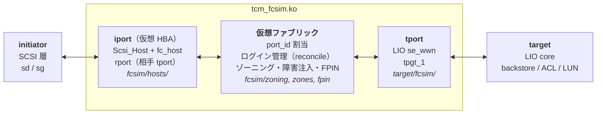
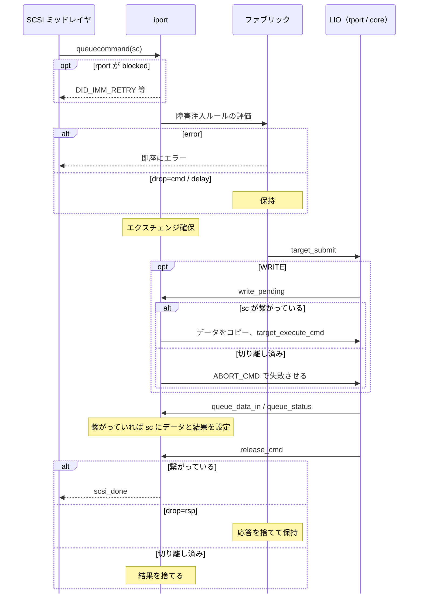

# tcm_fcsim 設計

FC HBA なしで「FC ストレージ」をエミュレーションする Linux カーネルモジュール。

- initiator 側には本物の FC HBA と同じく `/sys/class/fc_host`・`fc_remote_ports`・`fc_transport` が生える
  （`scsi_transport_fc` を使う SCSI LLD）
- target 側は LIO の fabric module として実装し、LUN・ACL は targetcli でそのまま管理できる
- 両者を同一モジュール内の仮想ファブリックでつなぐ（tcm_loop の FC 版。多対多）

対象カーネル: Linux 6.18 系（開発は v6.18.64 + virtme-ng）。

## 1. 全体像



斜体は設定する configfs（`/sys/kernel/config/` からの相対パス）。`fcsim/` は独自 configfs で `fcsimctl` が、
`target/fcsim/` は LIO の configfs で targetcli が扱う。

<details>
<summary>テキスト版</summary>

```
            ┌──────────────────── tcm_fcsim.ko ────────────────────┐
 initiator  │  iport (仮想 HBA)        仮想ファブリック       tport  │  target
 SCSI層 ◀──▶│  Scsi_Host + fc_host ◀──▶ port_id割当   ◀──▶ LIO se_wwn│◀──▶ LIO core
 sd/sg      │  rport (相手 tport)       ログイン管理        tpgt_1   │    backstore
            │                          (reconcile)                  │    ACL / LUN
            └──────────────────────────────────────────────────────┘
 設定:      /sys/kernel/config/fcsim/...            /sys/kernel/config/target/fcsim/...
            (独自 configfs)                          (LIO configfs = targetcli)
```

</details>

## 2. 決定事項

| 項目 | 決定 |
|---|---|
| 名前 | モジュール `tcm_fcsim`、LIO fabric 名 `fcsim`（nvme の `/sys/class/fcloop` と衝突させない） |
| ファブリックの置き場所 | カーネル内には「仕組み」（ポート・port_id・ログイン/ログアウト・link 状態・既定の全対全接続）だけを置く。ゾーニング定義や障害シナリオ等の「ポリシー」は将来ユーザ空間ツールが configfs に書く |
| ACL 無し initiator の扱い | tcm_qla2xxx と同じ既定値: `generate_node_acls=1`, `demo_mode_login_only=1`, `demo_mode_write_protect=1`, `cache_dynamic_acls=1`。= ログインは通り rport は見えるが、LUN は明示 ACL を持つ initiator にしか見えない。TPG attrib で変更可能 |
| target 側の fc_host | 出さない（target 側のエミュレーションは目的外） |
| WWN 表記 | configfs 上は小文字コロン区切り `xx:xx:xx:xx:xx:xx:xx:xx`（tcm_qla2xxx と同じ）。rtslib の naa 形式（`naa.` + 16 桁）と相互変換できるのは、先頭の hex 桁が 1, 2, 5, c-f のものだけ（rtslib の制約）。カーネルと `fcsimctl` は 0 以外の任意の 64 bit を受け付けるので、例えば `30:00:…` の initiator は作れるが、その ACL は targetcli では作れない（`fcsimctl host create` が警告する） |

## 3. オブジェクトモデル

| オブジェクト | 実体 | 主な属性 |
|---|---|---|
| ファブリック | モジュール内に 1 つ | switch WWN（`fabric_name`）、Domain ID `0x01`、port_id = `0x01AA00`（AA = 1..254 を IDA で払い出し） |
| iport | `Scsi_Host` + `fc_host` | WWPN（ディレクトリ名）、WWNN（既定は WWPN の先頭バイトを `0x20` にしたもの。WWPN の先頭が既に `0x20` なら、WWPN と同じにならないよう bit 60 も反転する）、port_id、port_state、speed、link |
| tport | LIO `se_wwn` + `tpgt_1`（1 つのみ） | WWPN（ディレクトリ名）、WWNN、port_id、online = TPG 登録済み かつ `enable=1` |
| nexus | ログイン済み (iport, tport) の組 | initiator 側 `fc_rport`、target 側 `se_session` |

### ログイン / ログアウト（reconcile 方式）

状態変更（host 作成/削除、link up/down、TPG enable/disable/削除、ACL 作成、LIO からの close_session 等）は
`fcsim_mutex` の下で状態フラグを書き換えた後、単一の ordered workqueue 上の **reconcile** を起動する。
reconcile は「あるべき nexus 集合」と現状を突き合わせ、差分をログイン/ログアウトする。

- あるべき nexus: iport が link up かつ削除中でない × tport が online、かつ LIO から close 要求されていない
- target に拒否されたログイン（ACL 無し・demo mode 無効）は reconcile のたびに再試行するが、ログ（info）は
  結果が変わったときだけ出す。記録はログイン成功・tport の online 状態の変化・iport の link down で消える
- configfs の store/mkdir/rmdir（TPG attrib の store を含む）や TPG enable/drop からは reconcile 完了まで待つ（同期）。
  ACL 作成・close_session など LIO のロックを持っている可能性がある経路からは起動のみ（非同期）。
  そのため ACL を削除した直後は、古いセッションがまだ残っていることがある

ログイン:
1. `target_setup_session(tpg, ..., initiator=iport WWPN, private=nexus)`
   — ACL 無しかつ demo mode 無効なら `-EACCES` → ログイン拒否（rport は作らない）
2. nexus を iport の RCU リストに追加（I/O パスから検索可能にする）
3. `fc_remote_port_add(shost, 0, {wwnn, wwpn, port_id, FCP_TARGET})` → transport が自動スキャン（REPORT LUNS は LIO が ACL に従って応答）

ログアウト:
1. `fc_remote_port_delete(rport)` → I/O ブロック、dev_loss_tmo / fast_io_fail_tmo 開始
2. nexus を RCU リストから外し、iport の draining リストへ移す
3. その組の開いているエクスチェンジを全て終了（LOGO は暗黙に全エクスチェンジを abort する）。
   sc は `DID_TRANSPORT_DISRUPTED` で返り、ミッドレイヤが再ログイン後に再試行する
4. **セッションの drain は別 workqueue で非同期に行う**（`fcsim_mutex` の外）:
   `synchronize_rcu()` → `target_stop_session` → `target_wait_for_sess_cmds` → `target_remove_session`。
   バックエンドで止まったコマンドがあっても、ファブリックの他の操作は止まらない
5. 同じ (iport, tport) の組は、古いセッションの drain が終わるまで再ログインしない
   （古いコマンドが再試行された新しいコマンドを追い越してバックエンドに届くのを防ぐ）。
   drain 完了で reconcile を起動する
6. TPG 削除・host 削除は、そのポートの drain 完了を待ってから進む（`fcsim_wait_drained`）

LIO の `close_session`（ACL 削除等）との排他: `target_shutdown_sessions` は `nacl_sess_lock` の下で
未停止のセッションを ACL のリストから外し、ロックを外してから `close_session` を呼ぶ。
ログアウト側は同じロックの下で `target_stop_session` し、セッションが既にリストから外れていれば
`close_session` 実行中とみなして、その完了（nexus の `close_done`）を待ってから解放する。

同じ WWPN で dev_loss_tmo 内に再ログインすると transport は同じ rport / SCSI target を再利用する（multipath の path 復旧と同じ挙動）。

nexus の検索は `rport->dd_data` を使わず、iport の nexus リストを相手 WWPN で RCU 検索する
（`fc_remote_port_add` は rport 再利用時に `dd_data` をゼロクリアし、かつ戻る前に ONLINE にするため）。

ファブリックへの参加・離脱（tport の online 状態の変化）は、link up 中の全 iport に
`FCH_EVT_RSCN`（data = tport の port_id）として netlink で通知する。link up/down は `FCH_EVT_LINKUP/LINKDOWN`。

## 4. I/O パス（エクスチェンジ）

コマンドごとにエクスチェンジ `struct fcsim_cmd` を sc とは別に確保する（kmem_cache、`SLAB_TYPESAFE_BY_RCU`）。
実機の HBA が自前の I/O コンテキストを持つのと同じく、initiator 側はいつでもエクスチェンジを
**終了**（sc を切り離してミッドレイヤへ返す）でき、LIO がまだ処理中でも構わない。
切り離し後に LIO が返す結果・データは捨てる。データは LIO 自身のバッファとの間でコピーする
（SGL の pass-through はしない。切り離した後で LIO が initiator のページに触れないようにするため）。



<details>
<summary>テキスト版</summary>

```
queuecommand(sc)
  fc_remote_port_chkready(rport)              … blocked なら DID_IMM_RETRY 等
  障害注入ルールの評価                         … error: 即応答 / drop=cmd・delay: ファブリックで保持
  エクスチェンジ確保（cdb・LUN・長さ・方向をコピー）、scsi_cmd_priv(sc)->cmd に公開
  deliver: nexus 検索 → target_init_cmd → target_submit_prep(cdb, SGL 無し) → target_submit
LIO
  write_pending  → sc が繋がっていれば sc の SGL → LIO のバッファへコピーして target_execute_cmd。
                   切り離し済みなら TCM_CHECK_CONDITION_ABORT_CMD で失敗させる（qla2xxx と同じ）
  queue_data_in  → 繋がっていれば LIO のバッファ → sc へコピー、result・sense・residual を設定
  queue_status   → 同上（データ無し）
  release_cmd    → 繋がっていれば scsi_done（drop=rsp なら応答を捨ててファブリックで保持）
```

</details>

- 参照: SCSI 側（切り離しで落とす）と LIO 側（`release_cmd` で落とす）の 2 本。sc とのリンクは `cmd->lock` の下で扱う
- `scsi_done` は RCU read 区間内で呼ぶ。EH はエクスチェンジが既に切り離されていた場合、
  `synchronize_rcu()` で実行中の `scsi_done` を待ってから sc をミッドレイヤへ返す（再発行との競合防止）
- ファブリックが保持中（遅延・drop）のコマンドは `cmd->held` とタイマーで表す（`iport->fault_lock` でタイマーと排他）。
  終了時はタイマーを同期削除する

### エラー処理（SCSI EH）

| ハンドラ | 動作 |
|---|---|
| `eh_timed_out` | `fc_eh_timed_out`（rport が blocked ならタイマー延長） |
| abort | ファブリックが保持中ならそのまま終了。LIO に渡っていれば `TMR_ABORT_TASK` を送り、COMPLETE / TASK_DOES_NOT_EXIST なら終了して SUCCESS、応答なしなら FAILED（エスカレート） |
| device reset | `TMR_LUN_RESET` が COMPLETE なら当該 LUN のエクスチェンジを全て終了 |
| target reset | LIO は TARGET RESET TMF を拒否するため、target 配下の全 LUN に LUN RESET を送り、target のエクスチェンジを全て終了 |
| host reset | HBA リセット: そのポートの全エクスチェンジを終了して常に SUCCESS。ログインは維持（直後に EH が送る TUR を通すため） |

- host reset 以外は先に `fc_block_scsi_eh`。FAST_IO_FAIL なら対象を `DID_TRANSPORT_FAILFAST` で終了して返す
  （host reset は rport を持たないので呼ばない）
- TMR の応答待ちは `tmr_timeout` 秒（既定 10、1〜3600）で打ち切る。LIO の TMR は TAS 無しで abort されると
  `queue_tm_rsp` の代わりに `aborted_task` が呼ばれ ACK 参照を LIO 自身が落とすため、
  応答あり / abort された / EH が諦めた、の 3 状態で ACK 参照の受け渡しを管理する
- `terminate_rport_io`: fast_io_fail_tmo / dev_loss_tmo 満了時、その rport の全エクスチェンジを
  `DID_TRANSPORT_FAILFAST` で終了する。これで rport 属性 `fast_io_fail_tmo` が機能する（multipath の高速フェイルオーバ）
- バックエンドが止まった場合: EH は TMR 無応答 → … → host reset でエクスチェンジを終了して成功し、
  再試行を使い切った I/O はエラーになる。デバイスは offline にならない。LIO 側の止まったコマンドは
  バックエンドが戻るまで残り、そのセッションの drain も待ち続ける

### 障害注入（ファブリック）

ファブリック（initiator と LIO の間）で、コマンド単位に障害を起こす。ルールは (iport, 相手 tport) ごと、
または iport の全 tport（`any`）に対して置き、特定 tport のルールが優先する。

```
/sys/kernel/config/fcsim/hosts/<initiator WWPN>/faults/<target WWPN | any>/
  delay_ms      コマンドを target へ届けるまでの遅延
  drop          none | cmd（target に届かない）| rsp（target は実行するが応答が失われる）。
                TMR にも同じ意味で効く（cmd: TMR は target に届かない、rsp: target は ABORT TASK /
                LUN RESET を実行するが応答が失われる）。どちらも EH は tmr_timeout 待って失敗とし、
                エスカレートする
  error         none | transport (DID_ERROR) | busy | qfull | medium (03/11/00) | aborted (0B/00/00):
                target に届けず即座にこのエラーを返す
  probability   対象コマンドのうち影響させる割合 %（既定 100）
  count         あと何コマンドに影響させるか（-1 = 無制限、既定）
  injected      (ro) 影響させたコマンド数
```

TMR に効くのは `drop` だけで、`delay_ms` と `error` は TMR には適用しない（ルールが `drop=none` なら TMR は
ルールの対象外で、`count` も消費しない）。

カーネルは仕組みだけを持ち、シナリオ（いつ・どのパスを壊すか）はユーザ空間が組む。

## 5. 設定インターフェース

### target 側（LIO configfs / targetcli）

```
/sys/kernel/config/target/fcsim/
  version                       (ro; LIO は tfc_wwn_attrs を fabric 直下に置く)
  <target WWPN>/
    tpgt_1/
      enable
      node_name, port_id, sessions   (ro; WWN ディレクトリには属性を置けないので TPG に置く)
      attrib/{generate_node_acls, cache_dynamic_acls, demo_mode_write_protect,
              prod_mode_write_protect, demo_mode_login_only}
      lun/  acls/<initiator WWPN>/
```

targetcli 上では単一 TPG の fabric（qla2xxx と同じ）として `tpg1` を挟まず
`/fcsim/naa.XXXXXXXXXXXXXXXX/{luns,acls}` と見える。

### initiator 側 + ファブリック（独自 configfs）

```
/sys/kernel/config/fcsim/
  fabric_name, version          (ro)
  hosts/
    <initiator WWPN>/           mkdir で仮想 HBA ポート（Scsi_Host）が生える（link down）
      port_name, port_id, scsi_host, targets   (ro)
      node_name                 (rw, link down 中のみ変更可)
      link                      (rw: up / down（kstrtobool の 1/0/y/n も可）、作成直後は down)
      draining                  (ro) ログアウト済みで drain 中のセッション数
      faults/<target WWPN|any>/ 障害注入ルール（上記）
```

新しいポートは link down で作られ、`link` に up を書いたときに初めてファブリックに参加（ログイン）する。
LIO の TPG を設定してから `enable` するのと同じく、node_name や障害ルールを設定し終えるまで
ログインもスキャンも起きない。`fcsimctl host create` は既定でここまで（link up）行う。

fc_host の統計（`/sys/class/fc_host/hostN/statistics/`）は iport ごとの per-CPU カウンタから返す。
`fcp_{input,output,control}_requests`、`fcp_{input,output}_megabytes`、`tx/rx_frames`・`tx/rx_words`
（フレームサイズ 2048 とフレームのオーバーヘッド 9 ワードで換算）、`link_failure_count`（link down）、
`lip_count`（issue_lip）、`fcp_packet_aborts`（SCSI EH がコマンドの abort を試みた回数。既に完了していた、
ファブリックが保持中だった、FAST_IO_FAIL になったなど、ABTS を送らずに済んだ場合も数える）、`dumped_frames`（障害注入で失ったフレーム）、
`fc_xid_not_found`（終了済みのエクスチェンジに届いた応答）、`seconds_since_last_reset`。物理層のエラー類は 0。
`reset_statistics` はその時点の値を基準として記録する。
障害注入でも FCP_CMND は HBA を出ているので、`error` や `drop=cmd` のコマンドも要求数と `tx_frames` に数える。
`drop=rsp` で失われた FCP_RSP（TMR の応答を含む）は `dumped_frames` だけに数え、`rx_frames` には数えない。

### ゾーニング

単一の仮想スイッチ上の WWN ゾーニング。LIO の ACL（target 側の LUN マスキング）とは別の層で、
許可されない組はログイン自体が起きない。

```
/sys/kernel/config/fcsim/
  zoning/
    mode       off | on        編集用（commit で反映）。off は全対全（kstrtobool の 1/0/y/n も可）
    commit     (wo) 1 を書くと、編集中の構成（mode と zones/）をまとめて有効にする
    pending    (ro) 1: 編集中の構成が有効な構成と違う
    active     (ro, バイナリ属性で 1 ページを超えても読める) 有効な構成:
                 mode <off|on>
                 zone <name> <wwpn> <wwpn> ...
  zones/<name>/
    members    編集用。WWPN を空白・改行・カンマ区切りで（1 回の write で全置換、最大 128。超えると E2BIG）。
               読むと 1 行 1 つ
```

- ゾーンは最大 1024（超える mkdir は ENOSPC）。ゾーン名は `active` の 1 語になるので、印字可能な ASCII で
  空白とカンマを含まないもの（ディレクトリ名なので `/`・`.`・`..` も不可）

- mode on のとき、initiator と target は同じゾーンに入っていればログインできる（「あるべき nexus」の条件に追加）
- 編集はファブリックに影響しない。commit で不変なコピーを作って差し替え、reconcile を 1 回だけ走らせる
- RSCN: commit で見え方が変わった（ゾーンに入った・外れた）組の initiator に、その target の port_id で送る。
  target ポートの参加・離脱の RSCN も、そのポートとゾーンを共有する initiator にだけ送る（実機のスイッチと同じ）
- configfs は 1 回の write() を 1 回の store として扱うので、`members` は 1 回で書くこと
  （`printf '%s\n' a b > members` のように行ごとに write されると最後の 1 つだけが残る）。`fcsimctl` は 1 回で書く
- 取り消し（revert）は CLI が `active` を読んで `zones/` を作り直す

### FPIN（Fabric Performance Impact Notification）

ファブリック（スイッチ）が送る通知を、ユーザ空間の指示で発生させる。

```
/sys/kernel/config/fcsim/fpin   (wo) 1 回の write で 1 通知
  li <wwpn> [event] [count=N] [threshold=ms]     Link Integrity（そのポートのリンクにエラー）
  pn <wwpn> [event] [period=ms]                  Peer Congestion（そのポートが輻輳）
  dn <wwpn> [reason]                             Delivery（そのポートとのフレームが破棄された）
  cn <initiator wwpn> [event] [severity=warning|error] [period=ms]   その initiator 自身のリンクの輻輳
```

- event の名前（最初のものが既定）。省略時の値は count=1、threshold=1000、period=1000、severity=warning
  - li: link_failure, loss_of_sync, loss_of_signal, prim_seq_err, invalid_tx_word, invalid_crc, device_specific, unknown
  - pn / cn: credit_stall, lost_credit, oversubscription, device_specific, clear
  - dn: timeout, unable_to_route, device_specific, unknown
- 宛先: target ポートについての通知は、link up でそのポートとゾーンを共有する全 initiator へ。
  initiator ポートについての通知は、そのポートだけへ
- 実際の ELS FPIN と同じ形のペイロードを組み、`fc_host_fpin_rcv()` に渡す。FC transport が fc_host / rport の
  `statistics/fpin_*` を数え、FC netlink イベント（`FCH_EVT_LINK_FPIN`）として流す
- LI / PN の port name list には対象ポート自身を入れる（multipathd はこのリストだけを見る。
  カーネルは attached port と同じものを重複して数えない）。detecting port は対象ポートがつながる仮想スイッチのポート
- 記述子はカーネルの uapi の構造体（`include/uapi/scsi/fc/fc_els.h`）で組む。PN の `struct fc_fn_peer_congn_desc` は
  `pname_count` の後に 4 バイトの詰め物があり、port name list がオフセット 40 から始まる（FC-LS では 36）。
  カーネルも multipathd もこの構造体で読むので、それに合わせている（実機の HBA から届く PN とは 4 バイトずれる）
- multipathd の `marginal_pathgroups fpin` は LI を受けると該当パスを marginal にし（rport の `port_state` を
  `Marginal` に書き換える）、別のパスグループへ移す。そのホストの LINKUP / RSCN で元に戻す

### initiator 側 CLI（`tools/fcsimctl`）

configfs を直接触らずに操作するための Python スクリプト（追加依存なし）。

```
fcsimctl status [--json]                    ファブリック全体（target ポート、host、rport、LUN、障害ルール）
fcsimctl host create|delete <wwpn> [--wwnn X] [--link up|down]
fcsimctl link <wwpn> up|down
fcsimctl lip <wwpn>
fcsimctl fault list | set <i> <t|any> attr=value... | clear <i> [<t|any>]
fcsimctl stats <wwpn> [--reset]
fcsimctl zone list | create <name> [wwpn...] | delete <name> | add|remove <name> <wwpn>...
fcsimctl zone mode on|off | commit | revert
fcsimctl fpin li|pn|dn|cn <wwpn> [event] [key=value...]
fcsimctl save|restore <file.json>           ゾーニング（編集中の構成）・host・link・障害ルール
                                            （target 側は fcsim-targetctl で別に。ただし LIO 全体が対象。restore は入力を検証してから現在の構成を消し、ゾーニングを先に commit してから host を作る）
fcsimctl clear
```

WWPN は `10:00:...`、`naa.1000...`、`0x1000...`、`1000...` のいずれでもよい。
`fcsimctl --help` に全サブコマンドと FPIN の event 名を載せている。

`/sys/class/fc_host/hostN/issue_lip` に書くと、未ログインの組み合わせを再試行し、online の rport を再スキャンする
（`fc_user_scan` と同じく host_lock の下で online のものだけ）。

モジュールパラメータ（`/sys/module/tcm_fcsim/parameters/`）:

| 名前 | 既定 | 意味 |
|---|---|---|
| `tmr_timeout` | 10 | EH が TMR の応答を待つ秒数（1〜3600。範囲外は ERANGE） |
| `dbg_release_delay_ms` | 0 | テスト専用: 次の READ(10) / READ(16) の解放を遅らせる（1 回限り） |
| `dbg_close_delay_ms` | 0 | テスト専用: `close_session` の先頭で眠る |
| `dbg_deliver_terminate` | N | テスト専用: 次の TEST UNIT READY を `target_init_cmd()` の直後に EH abort 相当（`DID_ABORT`）で終了する（1 回限り） |
| `dbg_write_pending_terminate` | N | テスト専用: 次の WRITE(10) / WRITE(16) を、LIO がデータを求めた（`write_pending`）ところで EH abort 相当で終了する（1 回限り） |
| `dbg_commit_delay_ms` | 0 | テスト専用: 次のゾーニングの commit で、スナップショットを取ってから有効にするまで眠る（1 回限り） |

値が上限を超えたときのエラーは属性によって違う: 数値の範囲外は ERANGE（`tmr_timeout`、障害ルールの
`delay_ms`・`probability`・`count`）、ゾーンの members は E2BIG、ゾーン数は ENOSPC。

### targetcli 連携

AlmaLinux 9 の rtslib は fabric 一覧が Python コードに固定（qla2xxx すら無効化されている）。
当面は `fcsim` 用の FabricModule を登録してから targetcli を起動するラッパー（`tools/fcsim-targetcli`、
`tools/fcsim-targetctl` は save/restore/clear 用）を用意し、将来 rtslib-fb upstream にパッチを送る。
ラッパーは fabric を登録するだけなので、targetctl の各操作は fcsim に限らず **LIO 全体** が対象になる
（`save` は全 fabric を書き出し、`clear` は `RTSRoot().clear_existing()` で全体を消し、`restore` も既存の設定を消してから復元する）。
他の LIO 設定があるホストで fcsim だけを片付けるには、`fcsim-targetcli /fcsim delete naa.…` と
`/backstores/... delete` で個別に消す（`scripts/wsl-try.sh` と同じ）。
`targetctl clear` は fabric ディレクトリ（`/sys/kernel/config/target/fcsim`）を残すため、
rmmod 前に `rmdir` が必要（他の fabric と同じ）。

## 6. ソース構成

```
src/
  fcsim.h         共通定義
  fcsim_main.c    モジュール init/exit、ファブリック（port_id、reconcile、login/logout）、WWN ユーティリティ
  fcsim_ini.c     Scsi_Host / fc_function_template、エクスチェンジ、queuecommand、EH、rport add/delete
  fcsim_tgt.c     target_core_fabric_ops、LIO configfs（wwn/tpg/attrib/acl）
  fcsim_cfs.c     独自 configfs（/sys/kernel/config/fcsim）
  fcsim_fault.c   障害注入ルール（hosts/<wwpn>/faults）
  fcsim_zone.c    ゾーニング（zoning/、zones/）
  fcsim_fpin.c    ファブリックからの FPIN（fpin）
tools/fcsim-targetcli, fcsim-targetctl, fcsim_rtslib.py   targetcli 連携
tools/fcsimctl                                            initiator 側・ファブリックの CLI
scripts/run-guest-test.sh   ゲストでテストを 1 本実行し、出力と dmesg を .test-out/ に残す
scripts/check.sh            ホスト上の速いチェック（make check: shellcheck、Python の構文、fcsimctl のユニットテスト、checkpatch）
scripts/vng-run.sh          virtme-ng で開発用カーネル、または KIMG のカーネル（AlmaLinux 9 等）を起動
scripts/build-kernel.sh     開発用カーネル（KASAN / lockdep / kmemleak / UBSAN / DEBUG_OBJECTS）のビルド
scripts/build-wsl-kernel.sh 実行中の WSL2 カーネルと同じソース・設定のツリーを取得・ビルド
scripts/wsl-try.sh          実機の WSL2 カーネルで確認を取りながら試す（読み込み → ramdisk の LUN への I/O）
packaging/                  AlmaLinux 9 向け DKMS RPM の spec と dkms.conf（make rpm）
build/<release>/            開発用以外のカーネル向けのビルド（make el9 / make wsl / make KVER=...）
tests/            virtme-ng ゲスト内で実行するテスト（make test の対象は smoke〜reload の 20 本）
  lib.sh, guest-setup.sh                     共通の関数、ゲストの準備（D-Bus など）
  kmemleak.sh                                各テストの前後で kmemleak を確かめる（run-guest-test.sh が呼ぶ。
                                             kmemleak の無いカーネルでは何もしない）
  fc-events.py                               FC transport の netlink イベントを表示する
  smoke-fcsim.sh, smoke-fcsim-targetcli.sh   基本動作、targetcli 連携
  race-fcsim.sh {abort,close,deliver,write-pending}
                                             競合の回帰テスト（dbg_* パラメータで窓を広げる、または EH を演じる）
  fault-fcsim.sh                             障害注入（TMR への drop、any と特定 target のルールの優先を含む）、
                                             fast_io_fail_tmo、RSCN / link イベント（fc-events.py）
  eh-fcsim.sh                                成功する target reset（target 単位の終了）、EH 中の FAST_IO_FAIL
  scsi-fcsim.sh                              residual、LIO のセンス、ログイン中の LUN マップ変更（UA と issue_lip）、
                                             LUN 256 以上、TPG 属性（demo_mode_login_only、cache_dynamic_acls、
                                             demo / prod_mode_write_protect）
  held-fcsim.sh                              ファブリックが delay で保持中のコマンドの終了（link down、EH abort、
                                             ルール削除、タイマーとログアウトの競合、host 削除）
  devloss-fcsim.sh                           dev_loss_tmo の満了（rport が Not Present、sd の削除と再ログインでの復帰、
                                             blocked 中に積まれた I/O の失敗）
  stress-fcsim.sh [秒] [種]                  並行 I/O（8 本の dd ワーカーが検証しながら書く）の下で、link・TPG・
                                             障害ルール・issue_lip・LUN RESET を乱数で繰り返す（既定 60 秒、種を表示）
  hang-fcsim.sh                              バックエンド停止（dmsetup suspend）時の EH とファブリックの応答性
  multipath-fcsim.sh                         2 iport × 2 tport の dm-multipath フェイルオーバとデータ整合性
                                             （dmsetup で直接組んだマップ）
  multipathd-fcsim.sh                        multipathd（ALUA・service-time）: rport の fast_io_fail_tmo /
                                             dev_loss_tmo 設定、パスの自動復帰、全パスダウン時のキューイング
                                             （要 device-mapper-multipath、カーネルに SCSI_DH_ALUA / DM_MULTIPATH_ST）
  misc-fcsim.sh                              拒否ログの抑制、1 ページを超える一覧（fcsimctl status の件数も）、
                                             TPG 属性（store がログインを待つこと）、tmr_timeout の範囲、TPG 名の検証、
                                             同じ WWPN の initiator / target の同時作成、port_id の枯渇（254 個）、
                                             fcsimctl restore の途中失敗と未知のキーの拒否、WWPN の表記の検証
  cli-fcsim.sh                               fcsimctl（作成・障害ルール・status・save/restore・使い方の誤り・ゾーン名の検査）、
                                             fcsimctl が持つカーネルの既定値・上限の写しとカーネルの一致、
                                             fc_host 統計（障害注入時の数え方を含む）、link up 中の node_name の拒否
  zone-fcsim.sh                              ゾーニング（ステージングと commit、RSCN の宛先、revert、save/restore、
                                             1 ページを超える active、並行する commit、最大構成、書き込み中のパスの消失と復帰、
                                             link down の initiator に RSCN を送らないこと、members の重複除去）
  fpin-fcsim.sh                              FPIN の宛先・統計・netlink（ELS のペイロードの各フィールド）、オフラインの
                                             target ポートについての FPIN、multipathd の marginal_pathgroups fpin
  reload-fcsim.sh [回数]                     読み込み・使用・取り外しの繰り返し（既定 20 回）、ゾーンが残ると rmmod を拒むこと
  test_fcsimctl.py                           fcsimctl の純粋な関数のユニットテスト（make check、VM 不要）
  wsl-try-guest.sh                           scripts/wsl-try.sh をゲストの WSL2 カーネルで実行（make test-wsl のみ）
  package-el9.sh                             DKMS RPM のインストール・利用・削除（make test-rpm）
  smoke-nvme-fcloop.sh, smoke-tcm-loop.sh    参考: nvme fcloop と tcm_loop の動作確認（make test には含めない）
```

テストの出力とゲストの dmesg は `.test-out/<名前>[-<TEST_TAG>].{log,dmesg}` に残る。各テストはゲスト内で
`TEST_TIMEOUT` 秒（既定 300）で打ち切り、その場合も dmesg を保存する。kmemleak のあるカーネル（開発用）では、
テスト中に漏れたメモリがあればテストは失敗する（`tests/kmemleak.sh`、起動時の漏れは数えない）。

未実装のテスト: ゾーン変更で rport・パス数が変わったときの multipathd の追従（stage3-plan.md の 3b で予定していたもの）。

## 7. 段階

| 段階 | 内容 |
|---|---|
| 1 (MVP) | 単一ファブリック・全対全、iport/tport、ログイン、rport・スキャン、READ/WRITE、link up/down、ABORT/LUN RESET、KASAN/lockdep 有効で作成〜削除〜rmmod がクリーン |
| 2（済） | エクスチェンジ化、非同期 drain、TMR タイムアウト、target/host reset、`terminate_rport_io`（fast_io_fail_tmo）、障害注入（遅延・無応答・エラー応答）、RSCN、multipath テスト（2 iport × 2 tport） |
| 3 | `docs/stage3-plan.md` を参照。3a（済）: initiator 側 CLI、fc_host 統計。互換（済）: WSL2 / AlmaLinux 9、DKMS RPM。3b（済）: ゾーニング。G（済）: FPIN。保留: NPIV |

## 8. 既知の制限

- バックエンドで止まったコマンドは LIO から取り戻せない。initiator 側は EH で終了できるが、
  そのセッションの drain・TPG 削除・host 削除・その組の再ログインはバックエンドが戻るまで待つ
- reconcile は単一の ordered workqueue で、`fc_remote_port_add` はホストの scan work を flush する。
  EH 中のホストで scan が保留されているとき、そのホストへのログインが EH 終了まで待たされ、その間 reconcile 全体が止まる可能性がある。
  FC transport の workqueue が `WQ_MEM_RECLAIM` でないため、reconcile の workqueue も `WQ_MEM_RECLAIM` にしない
  （メモリ逼迫時の前進は保証しない）
- データは LIO のバッファとの間でコピーする（pass-through しない）分、tcm_loop より CPU を使う
- T10-PI（DIF/DIX）は非対応
- LUN マップ変更時の自動再スキャンはしない（実機同様、LIO が REPORTED LUNS DATA HAS CHANGED の UA を返すのみ）。
  `issue_lip` で再スキャンできる
- 見える LUN が 1 つも無い間は SCSI 層が scsi_target を回収するため `fc_transport/target*` は現れない
  （rport は存在する。実機で LUN マスキングされていないアレイと同じ挙動）
- `sessions` / `targets` 属性は configfs の 1 ページ（約 170 ポート）に収まらない分を `... N more` と表示する
